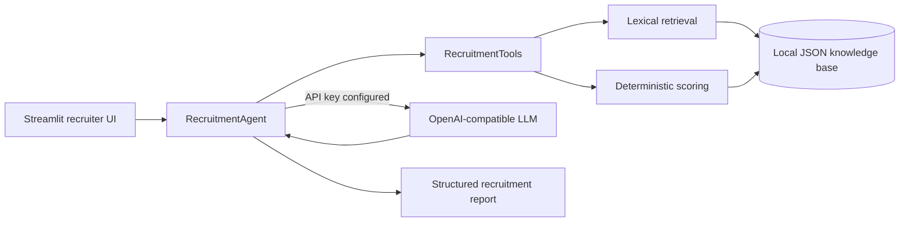
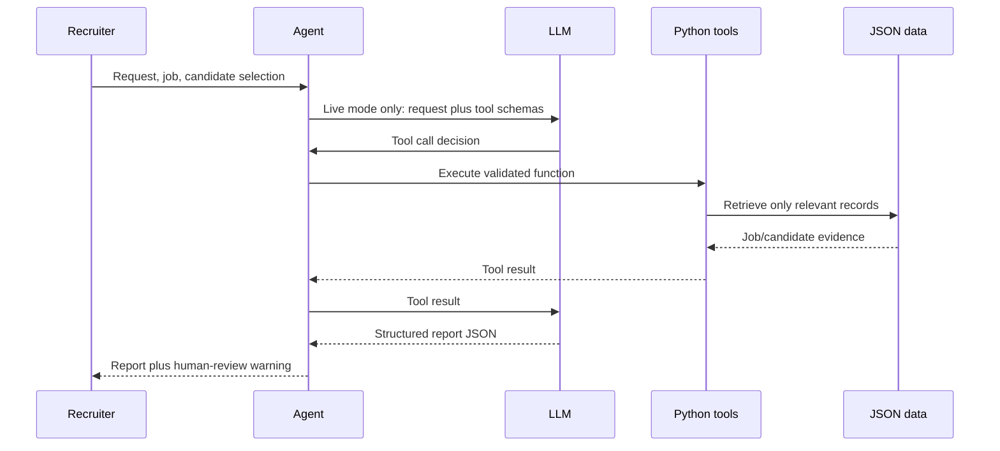

# Architecture

## Runtime flow

`src/scoring.py` is the source of truth for match percentages. The score is 60% mandatory skills, 20% preferred skills, 15% experience, and 5% relevant education. Explanations are generated from returned evidence; qualifications are never inferred beyond stored records. The application supports two execution modes: demo mode uses deterministic local tools and does not require a paid provider account; live provider mode can be enabled through `OPENAI_API_KEY` stored in the local `.env` file.

Demo reports provide the Streamlit UI with `candidates_evaluated`, `shortlisted_candidates`, and `human_review_required`. Live reports are accepted only when required top-level and candidate fields are present, the selected job/request/candidates match, evaluation data exactly matches deterministic Python tool output, and successful job, evaluation, and interview-question tool calls are recorded. The application rejects reports that do not preserve `human_review_required: true`. A human recruiter remains responsible for every final employment decision. Live provider verification was not completed because the configured API account had insufficient credits. Therefore, live provider execution and live tool-call verification are not claimed as verified; offline tests cover validation and mocked agent flow only.
